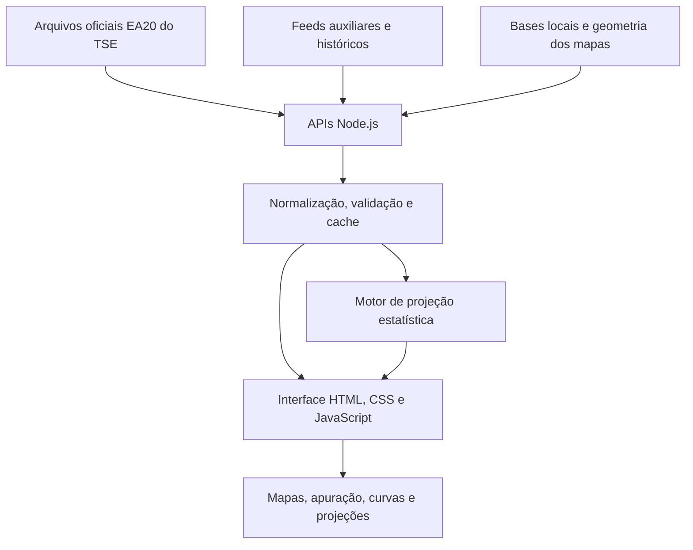

# Pulso Eleitoral 2026

**Dados públicos, visualização interativa e modelagem estatística da eleição brasileira de 2026.**

O **Pulso Eleitoral** é um projeto independente criado para acompanhar a apuração do segundo turno das eleições brasileiras de 2026. A aplicação reuniu resultados oficiais, mapas, séries temporais e modelos de projeção em uma interface acessível, com atenção à origem dos dados e à diferença entre **votos efetivamente apurados** e **estimativas estatísticas**.

> **Status: apuração encerrada.** O site agora consulta o arquivo versionado de resultados, sem polling, contador ao vivo ou projeção ao vivo. Os módulos de modelagem permanecem no código para documentação e testes. O projeto não é um serviço oficial de divulgação de resultados.

**Período analisado:** 1º turno (4/10/2026) e 2º turno (25/10/2026).  
**Stack:** JavaScript, Node.js 22+, HTML, CSS, SVG e APIs HTTP.  
**Repositório:** [github.com/flavio-silva0/pulso-eleitoral-2026](https://github.com/flavio-silva0/pulso-eleitoral-2026).

---

## Arquivo de encerramento

Os handlers de produção e o servidor local usam exclusivamente `lib/archive.mjs` e `data/election-archive.json`. Captura em 26/10/2026; carga nacional do TSE de 25/10/2026 às 23:27:02 (Brasília), com 100% das seções. Consultar o site não muda a data da carga. O total BR já inclui o exterior, que não é somado novamente ao placar. A indicação de eleito vem do campo oficial.

Foram preservados os resultados presidenciais de BR, 27 UFs e ZZ, arquivos disponíveis de governador, curvas dos turnos e feeds dos mapas. Os JSONs brutos diretamente obtidos do TSE estão em `data/raw/`. Ausência de arquivo estadual de segundo turno não implica resultado zero.

A contagem auxiliar por cidade do exterior tem cobertura parcial (776 de 1.351 seções) e é identificada como histórica, diferente da totalização final oficial de ZZ disponível no placar. Detalhes municipais podem ter cobertura parcial por indisponibilidade ou limitação das consultas de origem. `reconciliation` registra divergências entre soma municipal disponível e total estadual; registros ausentes não são apresentados como zero votos. O mapa compacto auxiliar possui margem arredondada e não serve para reconstruir votos exatos.

`/api/presence` responde HTTP 410; `/api/projecao` serve a demonstração estática de `data/projection-archive.json`, recalculada com os dados arquivados das 27 UFs, sem exterior (logit com alternativa por UF), sem inventar um histórico de previsões da noite; `/api/archive` informa a captura e a cobertura. O script `scripts/archive-results.mjs` não executa no build nem em produção; qualquer recaptura exige revisão das fontes e da reconciliação.

## O que foi construído

| Módulo | Funcionalidades |
| --- | --- |
| **01 · Mapa eleitoral** | Mapa de calor do Brasil com detalhamento por município, visão por região e UF, navegação com zoom e mapa mundial dos votos brasileiros no exterior. A intensidade das cores representa a vantagem proporcional entre os dois candidatos. |
| **02 · Apuração** | Consulta à votação para presidente e, onde aplicável, governador; total nacional, UFs e exterior; votos nominais e percentuais, seções totalizadas, comparecimento, abstenções, brancos e nulos. Inclui favoritos locais, exportação CSV e modo telão. |
| **03 · 1º × 2º turno** | Comparação das curvas históricas de apuração presidencial, com eixos por horário real, horários de início alinhados ou percentual de seções totalizadas. Permite alternar entre o confronto direto dos candidatos e a participação sobre todos os votos válidos. |
| **04 · Projeção estatística (histórico do projeto; demonstração disponível na aba 4)** | Estimativa do resultado final a partir de dados parciais, com método principal de *Logit Swing Municipal*, cenários alternativos, faixas de incerteza, probabilidade estimada de vitória e análise das 27 UFs. |

### Destaques de engenharia

- Consumo e normalização dos arquivos **EA20 do TSE**, com validações de turno, eleição, abrangência e cargo.
- Separação entre fontes oficiais, feeds históricos/auxiliares e cálculos produzidos pelo próprio projeto.
- Cache em memória, deduplicação de consultas simultâneas, tratamento de falhas e preservação da última resposta válida quando disponível.
- Interface responsiva desenvolvida com **JavaScript nativo**, sem framework de frontend ou dependências de execução instaladas pelo npm.
- Visualizações próprias em SVG, incluindo cartografia interativa, curvas temporais e indicadores de incerteza.
- Testes automatizados de normalização, dados externos, séries e projeções usando o test runner nativo do Node.js.

## Como interpretar os dados

O painel trabalha com três categorias de informação que **não devem ser confundidas**:

| Tipo | Significado |
| --- | --- |
| **Resultado oficial** | Votos e indicadores publicados nos arquivos de totalização do Tribunal Superior Eleitoral (TSE). |
| **Histórico ou contagem auxiliar** | Séries de apuração e boletins disponibilizados por feeds de terceiros, identificados separadamente e sujeitos à cobertura e disponibilidade de cada fornecedor. |
| **Projeção estatística** | Estimativa calculada pelo aplicativo com base nos dados já observados e em hipóteses sobre os votos ainda não apurados. **Não é resultado oficial.** |

Durante a apuração, a ordem de totalização das seções podia alterar significativamente os percentuais parciais: uma UF ou município que aparecesse primeiro não representava necessariamente o restante do eleitorado. Por isso, o projeto incorporou comparações territoriais e cenários de modelagem em vez de extrapolar apenas o percentual nacional momentâneo.

## Metodologia de projeção

O método padrão implementado em [`lib/projecao.mjs`](lib/projecao.mjs) é o **Logit Swing Municipal**. Ele compara o desempenho dos dois candidatos em municípios presentes no 1º e no 2º turnos, calcula a mudança relativa e a reaplica a uma distribuição nacional de referência.

Para um município `m`, a transformação utilizada é:

```text
logit(p) = ln(p / (1 - p))

swing_m = logit(p_m,2º turno) - logit(p_m,1º turno)
```

Aqui, `p` representa a proporção de votos de um candidato no confronto entre os candidatos 13 e 22, com tratamento numérico para valores extremos. O algoritmo pondera os deslocamentos observados, considera a distribuição de referência do 1º turno e estima a participação nacional ao final da contagem.

A implementação também calcula uma aproximação de incerteza a partir da dispersão dos deslocamentos observados e da fração ainda não apurada. A interface apresenta faixas visuais de **50%, 80% e 99%** no método logit, além de uma estimativa de probabilidade obtida por aproximação normal.

Outros métodos disponíveis para comparação:

- **Estratificado por UF:** combina variações locais e regionais para estimar a distribuição dos votos restantes em cada estado.
- **1º turno no restante:** aplica aos votos ainda não contados de cada UF a distribuição observada no primeiro turno.
- **Extrapolação direta:** mantém para os votos restantes de cada UF a proporção já observada naquela unidade.

**Limite metodológico:** os intervalos, probabilidades e critérios de definição antecipada são saídas de modelos sujeitos a hipóteses, viés de cobertura e erros de dados. Não representam garantias de acerto nem certificação pelo TSE. O motor principal utiliza transformações logit e aproximação normal; **não é uma simulação de Monte Carlo**. Encerrada a eleição, suas projeções devem ser interpretadas como parte do experimento analítico feito durante a apuração, não como substitutas do resultado final.

## Fontes e rastreabilidade

**Fonte primária:** [Tribunal Superior Eleitoral — divulgação de resultados](https://www.tse.jus.br/eleicoes/informacoes-tecnicas-sobre-a-divulgacao-de-resultados), com arquivos consultados em [`resultados.tse.jus.br`](https://resultados.tse.jus.br/). O código usa o ambiente `oficial/ele2026`, com identificadores de eleição `6258` (presidência) e `6260` (governos estaduais), sempre para o segundo turno.

**Fontes complementares previstas no código:**

- [seuimposto.com](https://seuimposto.com/) — séries temporais do 1º e 2º turnos, feed municipal auxiliar e boletins do exterior anteriores à consolidação da totalização oficial.
- [ApuraLogo](https://dados.apuralogo.com.br/) — feed municipal utilizado pelo motor de comparação estatística entre turnos.
- [IBGE](https://servicodados.ibge.gov.br/) e [Natural Earth](https://www.naturalearthdata.com/) — referências para representação geográfica do Brasil e do mundo.

A contagem auxiliar do exterior é identificada como tal e **não deve ser confundida nem somada em duplicidade** ao consolidado do TSE. Arquivos externos podem deixar de estar acessíveis depois do período eleitoral; sua disponibilidade atual não é garantida pelo repositório.

## Arquitetura



O projeto possui um servidor HTTP para execução local (`server.mjs`) e funções de API individuais em `api/`, previstas na configuração de deploy da Vercel. Não exige chave de API para sua configuração básica.

### Estrutura principal

```text
pulso-eleitoral-2026/
├── api/                 # Endpoints de resultados, mapas, curvas e projeções
├── lib/
│   ├── tse.mjs          # Fonte oficial e normalização dos resultados EA20
│   ├── exterior.mjs     # Validação e integração da contagem do exterior
│   ├── curva.mjs        # Histórico e alinhamento dos turnos
│   ├── projecao.mjs     # Motor estatístico e cenários alternativos
│   └── *.json           # Bases de referência eleitoral
├── public/
│   ├── index.html       # Estrutura da interface
│   ├── app.js           # Painel de resultados e interações gerais
│   ├── maps.js          # Mapas do Brasil, municípios e exterior
│   ├── curva.js         # Comparação visual entre turnos
│   ├── projecao.js      # Interface da projeção estatística
│   ├── style.css        # Estilos e responsividade
│   └── *.json           # Dados geográficos e referências locais
├── test/                # Testes automatizados
├── server.mjs           # Servidor HTTP local
├── package.json        # Comandos e requisito de Node.js
└── vercel.json          # Configuração para deploy
```

## Executar localmente

**Requisito:** Node.js **22 ou superior**. O projeto não declara dependências externas no `package.json`.

```bash
git clone https://github.com/flavio-silva0/pulso-eleitoral-2026.git
cd pulso-eleitoral-2026
npm start
```

Acesse **http://localhost:3000**. Para desenvolvimento e testes:

```bash
npm run dev
npm test
```

É possível definir a porta do servidor com a variável de ambiente `PORT`.

> A versão de encerramento serve resultados a partir do snapshot local versionado; a disponibilidade das antigas fontes externas não afeta essas consultas.

As descrições de cache, consultas externas e acúmulo de histórico acima documentam a arquitetura usada durante a apuração. Na versão atual, as rotas servem apenas o arquivo preservado. `npm test` executa os testes unitários; os roteiros `test/test-*-browser.mjs` são verificações manuais legadas de Chrome.

## Limitações e preservação histórica

- O histórico observado pela rota de apuração é acumulado **durante a execução**; não equivale automaticamente a uma reprodução integral da noite eleitoral.
- Na execução local, novas cargas podem ser registradas em `.runtime/snapshots.jsonl`. Esse diretório está no `.gitignore`, e os snapshots **não são reimportados automaticamente** ao reiniciar.
- As séries históricas obtidas de fornecedores externos dependem da preservação desses feeds por seus responsáveis.
- O percentual de **seções totalizadas** não é o mesmo que o percentual de **eleitores** ou de **votos** apurados.
- A cobertura municipal e do exterior pode variar segundo a disponibilidade e o estágio de consolidação de cada fonte.
- O repositório documenta uma ferramenta desenvolvida para a apuração de 2026; não constitui auditoria independente de boletins de urna, plataforma de certificação eleitoral ou serviço institucional do TSE.

## Sobre o projeto

O Pulso Eleitoral 2026 nasceu da ideia de que uma apuração eleitoral pode ser analisada com mais profundidade do que um placar isolado. O desenvolvimento combinou **engenharia de dados, integração de fontes públicas, visualização geográfica e modelagem estatística**, com uma preocupação central: deixar claro **o que já havia sido contado, o que ainda faltava e o que era apenas uma estimativa**.

Depois do segundo turno, o valor do projeto permanece no código, nas decisões de modelagem e nas visualizações construídas — um registro de como dados complexos e atualizados rapidamente podem ser apresentados de forma compreensível.

**Desenvolvido por [Flavio Silva](https://github.com/flavio-silva0).**  
*Projeto independente, sem vínculo institucional com o Tribunal Superior Eleitoral.*
